# LiftLog

A native Android workout tracker: build programs, log weight/reps, auto-start a rest timer, and see your full lifting history and progress.

## 📲 Download

**[⬇ Download the latest LiftLog for Android](https://github.com/Codyphil679/workout-app/releases/latest)**: open this on your phone and tap the `.apk` file under **Assets**.

Free, no account needed. Requires Android 8.0+ (not available for iPhone).
First time installing an app from outside the Play Store? Follow the **[step-by-step install guide](INSTALL.md)** ([PDF](docs/LiftLog-Install-Guide.pdf)).
New to the app? Read the **[user manual](docs/MANUAL.md)** ([PDF](docs/LiftLog-Manual.pdf)) or skim the **[feature list](FEATURES.md)**.

---

Kotlin · Jetpack Compose (Material 3) · Room · no account, no backend. All data stays on the phone.

## Features

**Full list: [FEATURES.md](FEATURES.md)** · **How to use it: [user manual](docs/MANUAL.md)** ([PDF](docs/LiftLog-Manual.pdf))

**Program builder**
- Programs → training days → exercises with target **sets × reps**, **starting weight**, and **rest time**
- **Auto-progression** per exercise:
  - *Linear*: hit every rep → add weight next time; miss two workouts in a row → drop 10%
  - *Double*: work up a rep range (e.g. 8–12); when every set hits the top → add weight, back to the bottom
  - *% of training max*: each set is a percentage of your training max (e.g. 75/80/85%, last set AMRAP). The AMRAP result moves the training max: miss the target → −10%, hit it → +5/10 lb, beat it by 5+ reps → double jump. The first training max is set to 90% of your best estimated 1RM if you don't enter one
  - Big barbell lifts default to linear (+5 lb upper / +10 lb lower), everything else to double progression
  - **RPE-aware**: if you log RPE, linear progression holds the weight after an RPE 10 day and doubles the jump when every set was RPE 7 or easier
- **Supersets**: link exercises; checking a set jumps you to the next exercise, rest starts after the round
- **Automatic warm-up sets** (bar, ~40/60/80%) per exercise
- **Readiness check-in** (optional): four 1–5 questions before a program day. A low score offers a lighter day (−10%); lighter days are ignored by progression and training-max changes
- **Program library** of seven starter programs, including a training-max strength program (Full Body A/B, 5×5 Strength, Upper/Lower, Push/Pull/Legs, Full Body Hypertrophy, Dumbbell Only)
- Reorder days and exercises, rename, delete
- 34 common exercises preloaded, plus create your own from the picker (long-press one to delete it if it isn't used anywhere)

**Workout logging**
- Start any program day (or a quick workout with no program). Home suggests **Up next**: the day after the last one you trained
- Sets pre-fill with **what you lifted last time** for that set; the program's starting weight is only used the first time
- Tap the "Prev" value to copy last time's set into the current one
- Check off a set → **rest timer auto-starts** with that exercise's rest time
- **Set types**: warm-up (W), failure (F), drop set (D). Warm-ups are kept out of history, records, volume and progression
- **Optional RPE** (6–10) per set
- **Plate calculator** (configurable bar weight) and one-tap warm-up sets in any workout
- Add/remove sets and exercises mid-workout, change rest per exercise
- Workouts survive the app being killed. Every keystroke is saved to the database

**Rest timer**
- Animated countdown ring in-app with −15 / +15 / Skip
- Runs as a foreground service with a live countdown notification, so it keeps going with the screen off or the app in the background
- Vibrates + plays a notification sound when rest is over

**Historian**
- **History**: every finished workout grouped by month, with duration, sets, and volume. Open one to see each set's weight × reps and the time since the previous set
- **Last time** shown inline on every exercise while you log
- **Progress** per exercise: chart of estimated 1RM (Epley), top weight, or volume over time; personal records (heaviest set, best e1RM, best-volume workout, most reps); every past workout for that lift
- **Recovery map**: front/back body map coloured Recovering / Ready / Fresh from your recent hard sets (simple, stated rule; not a physiological model)
- **Monthly recap**: workouts, hours, sets, volume, new estimated-1RM records, top lift/muscle, favourite day and week streak, shareable as an image
- **Health Connect sync** (optional): finished workouts are written to Android Health Connect as strength-training sessions with one segment per set (reps included). Write-only; LiftLog reads nothing
- **Weekly sets per muscle** with a 10–20 set target band (counts each exercise's main muscle)
- **Body tracking**: body weight, body fat and measurements with charts
- **Backup & export**: full JSON backup you can restore (e.g. on a new phone), and a CSV of every completed set for Excel/Sheets

**Settings**: lb/kg (lb by default; display-only conversion, data stored in kg), default rest, auto-start timer on/off.

## Screenshots

These are real renders of the app's Compose UI with sample data (Robolectric + Roborazzi), not mockups.

| Home | Logging a workout | Program day |
|---|---|---|
| 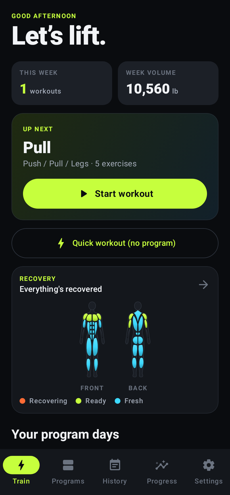 | 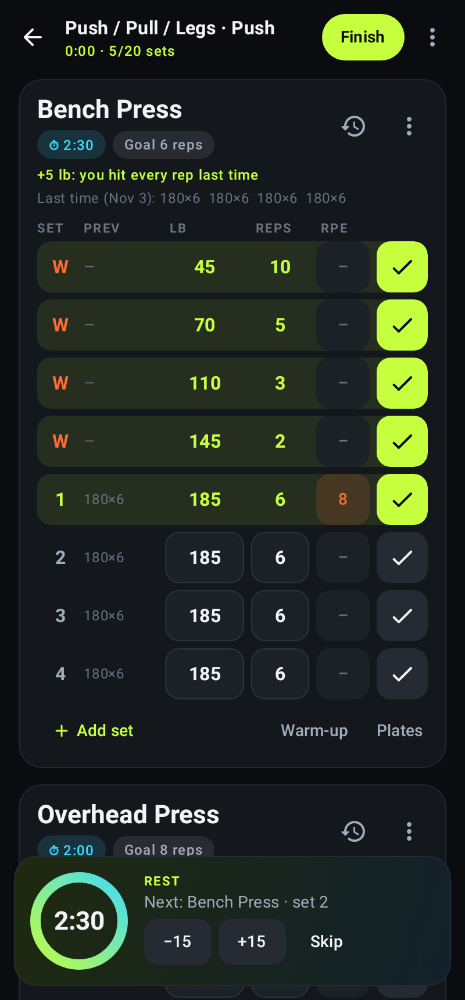 | 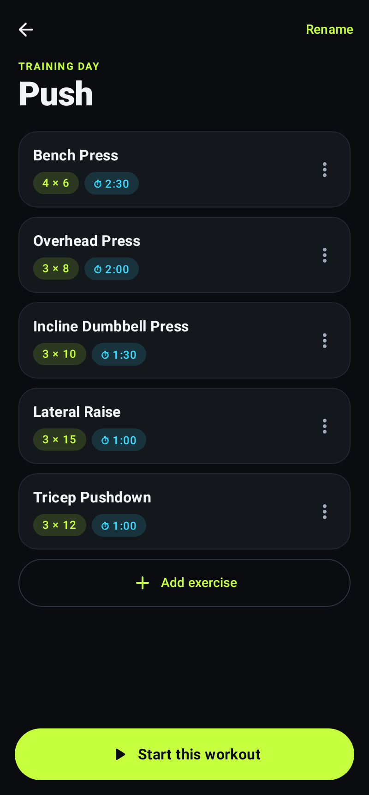 |

| Recovery map | Monthly recap | % training max day | Readiness check-in |
|---|---|---|---|
| 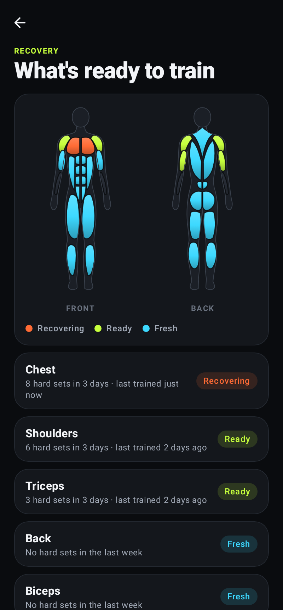 | 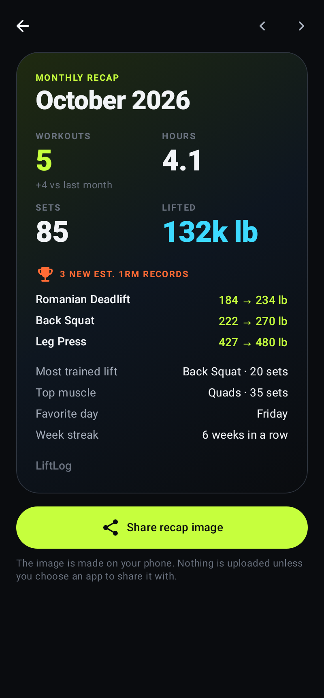 | 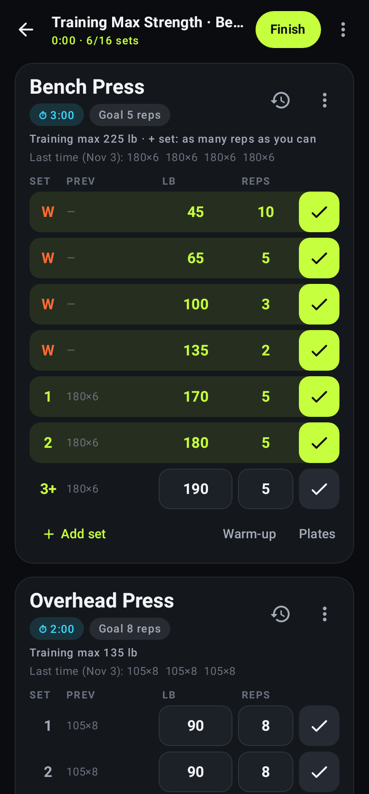 | 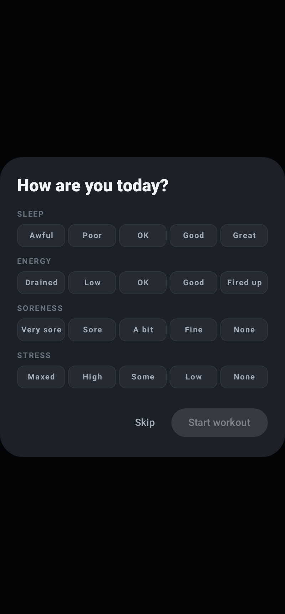 |

| Supersets | Plate calculator | Progress & weekly muscles | Body |
|---|---|---|---|
| 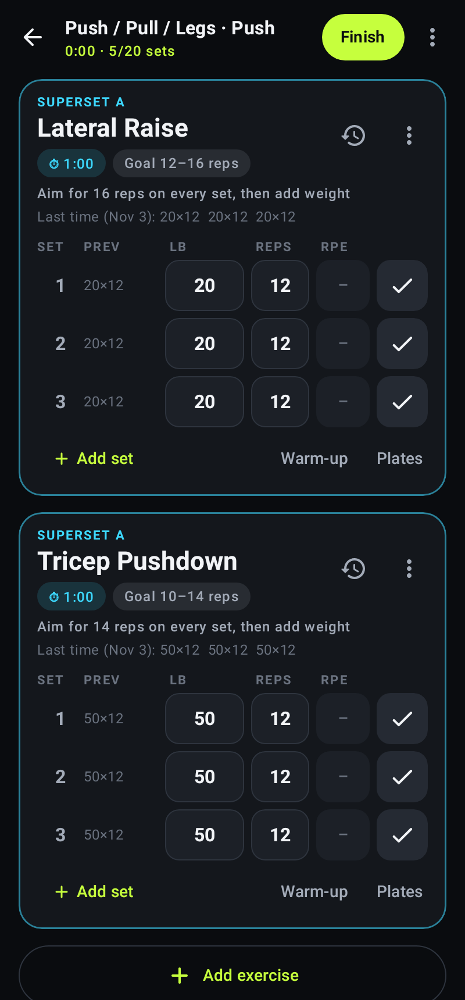 | 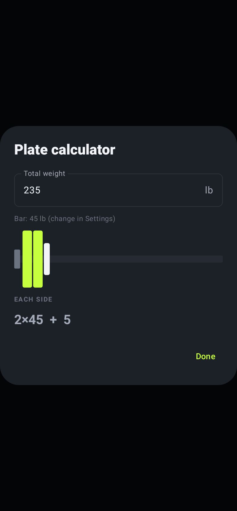 | 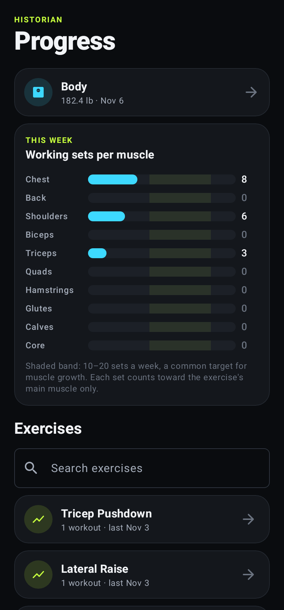 | 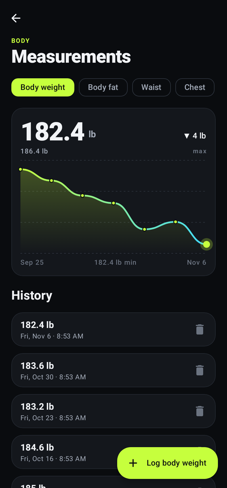 |

| History | Workout detail | Exercise progress | Settings |
|---|---|---|---|
| 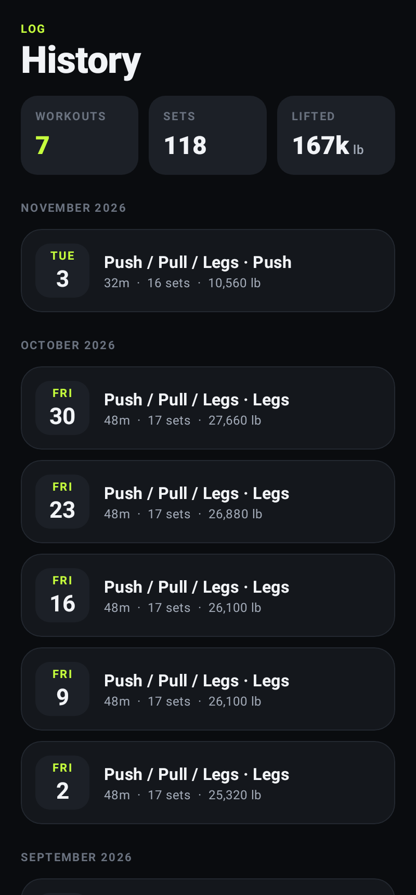 | 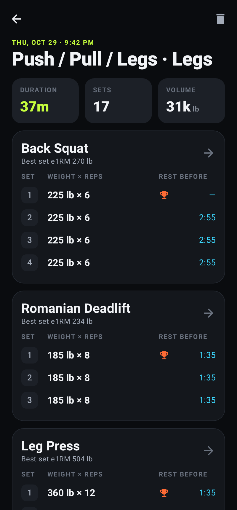 | 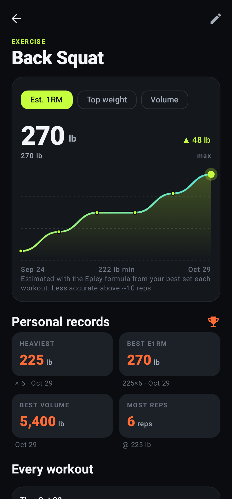 | 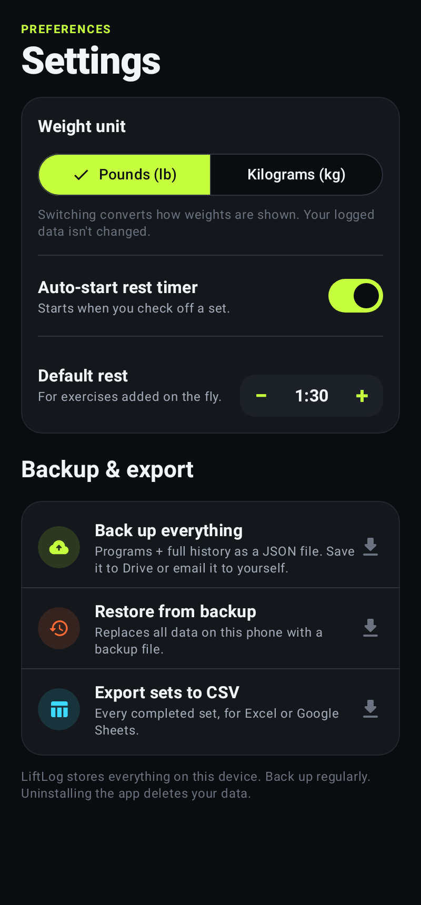 |

## Install on a phone (no developer tools)

See **[INSTALL.md](INSTALL.md)** (or the printable [PDF version](docs/LiftLog-Install-Guide.pdf)) for a step-by-step guide to downloading and installing the APK.

## Build & install

Requirements: JDK 17+ and the Android SDK (Android Studio installs both).

```bash
# Debug build
./gradlew :app:assembleDebug
# -> app/build/outputs/apk/debug/app-debug.apk

# Install on a connected phone (USB debugging on)
./gradlew :app:installDebug
```

Or open the folder in Android Studio and press Run.

Min Android version: 8.0 (API 26). Target: API 36.

## Tests

```bash
./gradlew :app:testDebugUnitTest
```

JVM tests (Robolectric, in-memory Room) cover: workout start/prefill logic, progression rules (add/hold/deload, rep ranges), warm-up and plate math, supersets, set types and RPE, weekly muscle counts, body metrics, the v1→v2 database upgrade on a real v1 database, rest tracking, finishing/discarding, history queries, reordering, exercise de-duplication, backup round-trip (v1 and v2 files), bad-file rejection, CSV output, unit conversion and PR math. `ScreenshotTest` regenerates the screenshots into `app/build/outputs/roborazzi/`.

## Known limitations / honest notes

- **"Rest before" in history is the time between completing consecutive sets.** It includes the time spent doing the set itself, so it reads ~20–60 s higher than pure rest. Measuring true rest would need a "start set" tap, which adds friction.
- **The rest timer uses a `specialUse` foreground service.** That's fine for sideloading. Publishing on Google Play requires justifying that service type in the Play Console.
- **The release build is signed with the debug key** so `assembleRelease` gives an installable APK. Set up your own signing key before publishing.
- **Health Connect sync and recap sharing are untested on a real device** (they need Health Connect / a share target, which the JVM test environment doesn't have). The record building is unit-tested.
- **The rest timer lives in memory.** If Android kills the app during a rest (aggressive battery managers on some phones), that rest's alert won't fire. A system alarm backstop would fix it; not done yet.
- **"Rest before" isn't recalculated** when you un-check a set or check sets out of order.
- **Rotating the phone closes the exercise-settings dialog** in the program editor (other key dialogs survive rotation).
- **No cloud sync.** Use Settings → Back up everything regularly. Android's automatic device backup also includes the database if you have it enabled.
- **The e1RM is an estimate** (Epley formula) and gets unreliable above ~10 reps.
- **The UI is dark-only by design**, and ignores Material You wallpaper colors to keep the brand look.

## Project layout

```
app/src/main/java/com/codyphil/liftlog/
  data/       Room entities, DAOs, repository, backup/export, templates, settings
  domain/     Units (lb/kg), stats (e1RM, PRs), formatting
  timer/      RestTimer state + foreground RestTimerService
  ui/         Compose screens: train, workout, programs, history, progress, settings, shared components, theme
```
