# LiftLog user manual

LiftLog builds your training program, tells you what to lift, times your rest, and keeps a complete history of every set. This manual covers every screen and setting. For installing the app, see the [install guide](../INSTALL.md).

**Contents**
1. [Getting started](#1-getting-started)
2. [Getting around](#2-getting-around)
3. [Programs](#3-programs)
4. [Progression: how LiftLog picks your weights](#4-progression-how-liftlog-picks-your-weights)
5. [Doing a workout](#5-doing-a-workout)
6. [The rest timer](#6-the-rest-timer)
7. [History](#7-history)
8. [Progress](#8-progress)
9. [Recovery map](#9-recovery-map)
10. [Body tracking](#10-body-tracking)
11. [Settings](#11-settings)
12. [Keeping your data safe](#12-keeping-your-data-safe)
13. [How the numbers are calculated](#13-how-the-numbers-are-calculated)
14. [Troubleshooting](#14-troubleshooting)

---

## 1. Getting started

1. **Allow notifications** when LiftLog asks. That's how the rest timer alerts you when your phone is in your pocket.
2. **Pick your units.** Go to **Settings → Weight unit** and choose pounds or kilograms. You can switch any time; it only changes how numbers are shown.
3. **Set up a program.** Go to **Programs** and tap one from the **Program library** (for example *Full Body A/B* if you're new, or *Push / Pull / Legs*). It's copied into your programs and you can change anything.
4. **Train.** Go to **Train** and tap **Start workout**.

The first time you do an exercise there's no history, so the weight fields are empty. Type the weight you're using. From the next workout on, LiftLog fills the weights in for you.

---

## 2. Getting around

The bar at the bottom has five tabs:

| Tab | What it's for |
|---|---|
| **Train** | Start a workout, see what's up next, this week's totals, recovery |
| **Programs** | Build and edit programs, the program library |
| **History** | Every finished workout, monthly recap |
| **Progress** | Charts, personal records, weekly sets per muscle, body tracking |
| **Settings** | Units, rest timer, coaching options, Health Connect, backup |

While a workout is running, the **Train** tab shows a **Workout in progress** card. Tap **Resume** to go back to it.

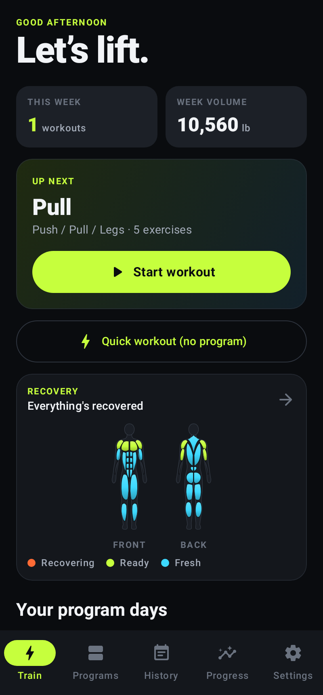

---

## 3. Programs

A **program** is a set of **training days** (e.g. *Push*, *Pull*, *Legs*). Each day lists **exercises**, and each exercise has its sets, reps, rest time and progression.

### Using a ready-made program
**Programs → Program library**, tap one. You get your own copy with progression, warm-ups and supersets already set up. Tapping the same program again makes a second copy.

| Program | Focus | Days |
|---|---|---|
| Full Body A/B | Beginner | 3×/week, alternating A and B |
| 5×5 Strength | Strength | 3×/week |
| Upper / Lower | Strength + size | 4×/week |
| Training Max Strength | Strength (% of training max, AMRAP sets) | 3–4×/week |
| Push / Pull / Legs | Muscle | 3–6×/week |
| Full Body Hypertrophy | Muscle | 3×/week |
| Dumbbell Only | Beginner, home gym | 3×/week |

### Building your own
1. **Programs → New program**, give it a name.
2. Tap **Add training day** and name it (e.g. "Push").
3. Open the day and tap **Add exercise**. Search the list, filter by muscle, or type a new name and tap **Create "…"**.
4. Set the exercise's targets (next section) and tap **Save**.

### Exercise settings
Tap any exercise in a day to change:

- **Progression**: None, Linear, Double or % TM ([section 4](#4-progression-how-liftlog-picks-your-weights)).
- **Sets** and **Reps**. With Double progression you set **Min reps** and **Max reps**.
- **Add each time**: how much weight progression adds (in 2.5 lb / 1.25 kg steps).
- **Starting weight**: only used the very first time. After that, progression decides.
- **Rest between sets**.
- **Add warm-up sets**: automatically adds warm-ups before the first working set ([section 5](#warm-ups)).

For % TM exercises you edit each set's percentage and reps, mark the AMRAP set, and enter the **Training max** instead of a starting weight.

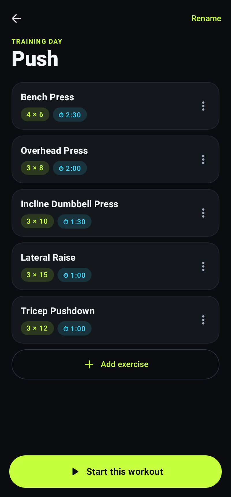

### Supersets
On a day, tap an exercise's **⋮ → Superset with next exercise**. Linked exercises get a blue border and a "Superset A" label. Repeat on the next one to add a third. **⋮ → Remove from superset** undoes it.

### Rearranging and deleting
- **⋮ → Move up / Move down** reorders days and exercises.
- **⋮ → Rename** renames a day; the program's own **⋮ → Edit name & notes** renames the program.
- Deleting a program or day **never deletes your history**. Workouts you've done stay in History.

---

## 4. Progression: how LiftLog picks your weights

Each exercise in a program uses one of four rules. The card in your workout tells you which rule fired and why, for example *"+5 lb: you hit every rep last time"*.

### None
Each set is pre-filled with what you did on the same set last time.

### Linear (default for big barbell lifts)
- **Hit every rep on every set** → next time, add the increment (default +5 lb for upper-body lifts, +10 lb for squats and deadlifts).
- **Missed some reps** → same weight next time.
- **Missed two workouts in a row at the same weight** → drop about 10% (rounded down to a weight you can load) and build back up.

### Double progression (default for everything else)
You work within a rep range, e.g. 8–12.
- Keep the weight and try to add reps.
- **When every set reaches the top of the range** → add weight and start again at the bottom (e.g. 12 → 8 reps).

### % of training max (% TM)
Used by *Training Max Strength*. Each set is a percentage of your **training max** (TM), which is usually set at about 90% of your true one-rep max. A set marked **+** is **AMRAP**: do as many good reps as you can.

When you finish the workout, the AMRAP set adjusts your training max:

| AMRAP result | Training max |
|---|---|
| Fewer reps than the target | −10% |
| Hit the target | + one increment (5 lb upper body / 10 lb lower body) |
| Beat it by 5+ reps | + two increments |

If you don't enter a training max, LiftLog sets it to 90% of your best estimated 1-rep max from your history. You can change it mid-workout: **⋮ → Set training max** on the exercise. The remaining sets are recalculated.

### How RPE affects progression
If you log RPE (Settings → Track RPE):
- You hit every rep but any set was **RPE 10** (nothing left) → hold the weight one more time.
- **Every set was RPE 7 or easier** → double the jump (linear progression).

### What's ignored
- **Warm-up sets** never count toward progression, records or volume.
- **Lighter days** (from the readiness check-in) are ignored too, so one bad day doesn't set you back.
- **A single heavier set** on top of your work sets doesn't become your new working weight.

---

## 5. Doing a workout

### Starting
- **Train → Up next → Start workout**: the day after the one you trained last in that program.
- **Train → Your program days**: tap **Start** on any day.
- **Quick workout (no program)**: start empty and add exercises as you go.
- Inside a program day: **Start this workout**.

Only one workout can run at a time. While one is in progress, the start buttons are disabled; finish or discard it first (or tap **Resume** on the Train tab).

### Readiness check-in
Before a program day, LiftLog may ask **How are you today?** (Sleep, Energy, Soreness, Stress, each from 1 to 5).
- If your average is **2.5 or lower**, you can choose **Lighter day (−10%)**: every working set is about 10% lighter, and the day doesn't count against your progression.
- **Train as planned** or **Skip** starts normally.

Turn the check-in off in **Settings → Coaching**.

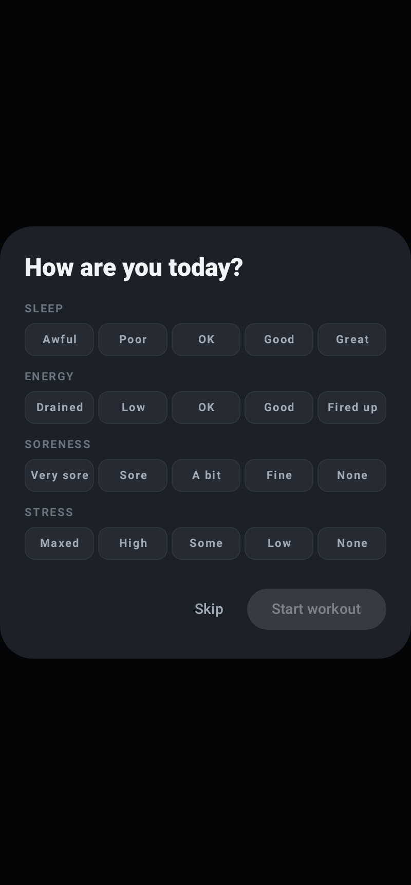

### The workout screen
Each exercise is a card:

- **⏱ 1:30**: this exercise's rest time. Tap to change it.
- **Goal**: the target reps (or range).
- **Progression note**, e.g. *"+5 lb: you hit every rep last time"*.
- **Last time**: what you did the previous time.
- **Set rows**:

| Column | Meaning |
|---|---|
| **Set** | Set number. **W** = warm-up, **F** = to failure, **D** = drop set, **3+** = AMRAP. Tap it for options. |
| **Prev** | That set last time. Tap it to copy it into the row. |
| **lb / kg** | Weight. Leave empty for bodyweight exercises. |
| **Reps** | Reps done. |
| **RPE** | (If turned on) how hard it felt, 6–10. |
| **✓** | Done. Starts the rest timer. Tap again to un-check. |

A red border on the weight means it isn't a valid number (e.g. ".") and the set can't be checked off until it's fixed.

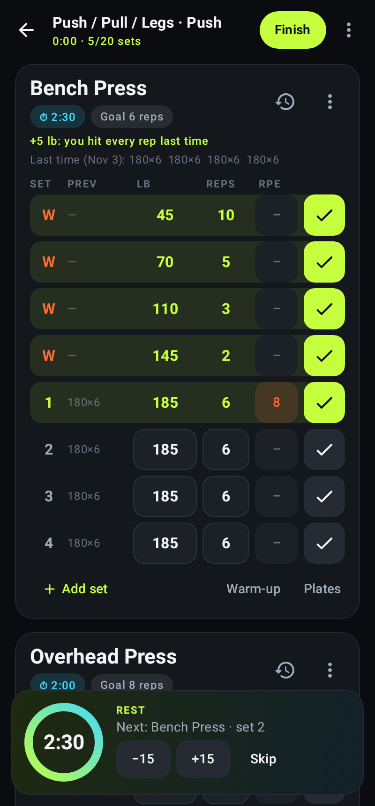

### Set options (tap the set number)
- **Normal set / Warm-up / To failure / Drop set**: change the set type.
- **AMRAP (as many reps as possible)**: toggle it.
- **Delete set**.

### Buttons under each exercise
- **Add set**: copies the last set's weight and reps.
- **Warm-up**: adds a warm-up ramp before your first working set: the empty bar × 10, then about 40% × 5, 60% × 3 and 80% × 2, rounded to loadable weights. Pressing it again replaces unfinished warm-ups instead of adding more.
- **Plates**: the plate calculator for the next set's weight. It shows what to put **on each side** of the bar.

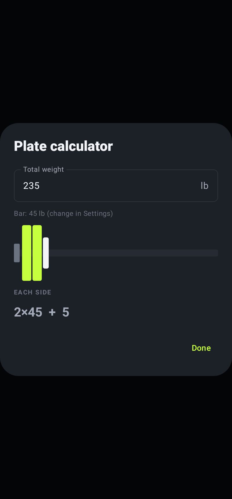

### Exercise menu (⋮ on the card)
Rest time · Add warm-up sets · Set training max · Superset with next exercise / Remove from superset · Move up / Move down · Remove exercise

The ⟲ icon opens that exercise's progress page.

### Supersets in a workout
When you check off a set in a superset, LiftLog scrolls straight to the next exercise in the group without resting. After the last exercise of the round, the rest timer starts.

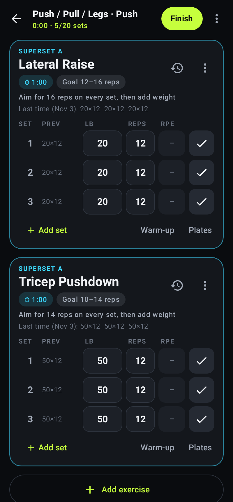

### Finishing
- **Finish** saves the workout. Any sets you didn't check off are removed. A workout with only warm-ups checked off can't be saved; you'll be offered to keep going or discard it.
- **⋮ → Discard workout** deletes it entirely.
- **⋮ → Rename workout**, or tap the title.

Everything is saved as you type, so closing the app or a crash doesn't lose your workout. Reopen LiftLog and tap **Resume**.

---

## 6. The rest timer

- It starts automatically when you tap ✓ (turn that off in Settings), using the exercise's rest time. Rest after warm-ups is capped at 60 seconds.
- The panel at the bottom shows a countdown ring with **−15**, **+15** and **Skip**. The ring turns orange in the last 10 seconds.
- It keeps running with the screen off or while you use other apps. The notification shade shows a live countdown with **+15s** and **Skip** buttons.
- When rest is over, the phone vibrates and shows **"Rest over — time to lift"**.

If notifications are blocked you'll still get the vibration but no pop-up. Turn them on in **Android Settings → Apps → LiftLog → Notifications**.

---

## 7. History

**History** lists every finished workout by month, with its duration, sets and volume. Totals at the top cover all time.

Tap a workout to see:
- every exercise and set (weight × reps, RPE as "@8"), with warm-ups greyed and marked **W**
- 🏆 on each exercise's best set
- **Rest before**: the time since the previous set was checked off. This includes the time spent doing the set, so it reads a little higher than pure rest.
- **Readiness** score and **Lighter day** tag, if used
- training-max changes from AMRAP sets

Tap the trash icon to delete a workout. This also removes it from Health Connect if sync is on. It can't be undone.

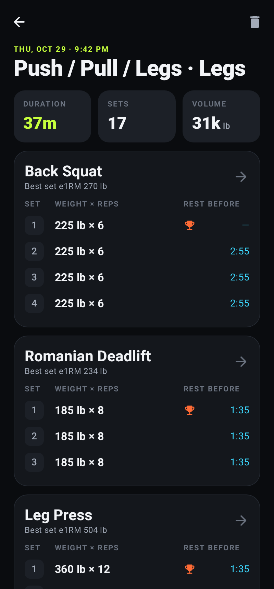

### Monthly recap
Tap the **Monthly recap** card at the top of History.
- The recap shows workouts (vs. last month), hours, sets, total weight lifted, new estimated-1RM records, your most-trained lift and muscle, favourite day, and week streak.
- Use the **‹ ›** arrows to change month.
- **Share recap image** makes a picture on your phone and opens the normal share menu. Nothing is uploaded unless you choose an app.

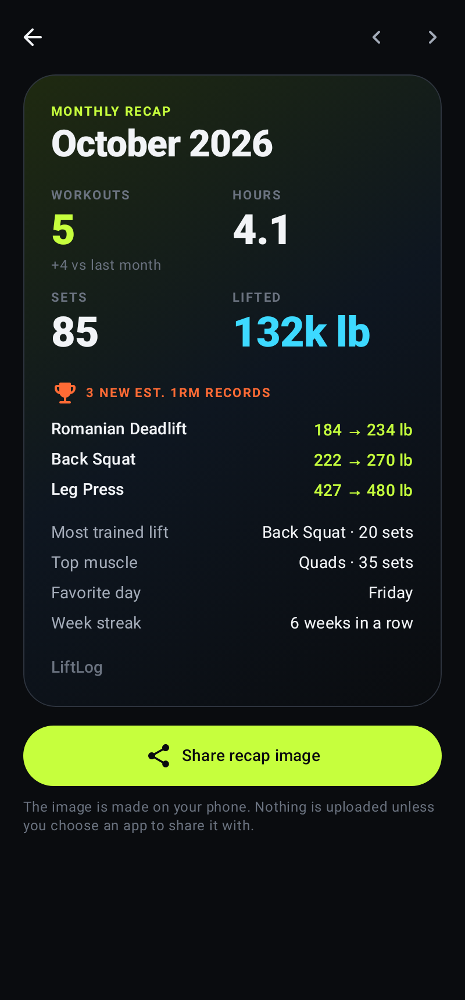

---

## 8. Progress

### Weekly sets per muscle
This shows how many working sets you've done for each muscle this week. The week starts on your phone's first day of the week (Sunday in the US). The shaded band marks **10–20 sets a week**, a common target for muscle growth. Each set counts toward the exercise's main muscle only (bench press counts as chest, not triceps).

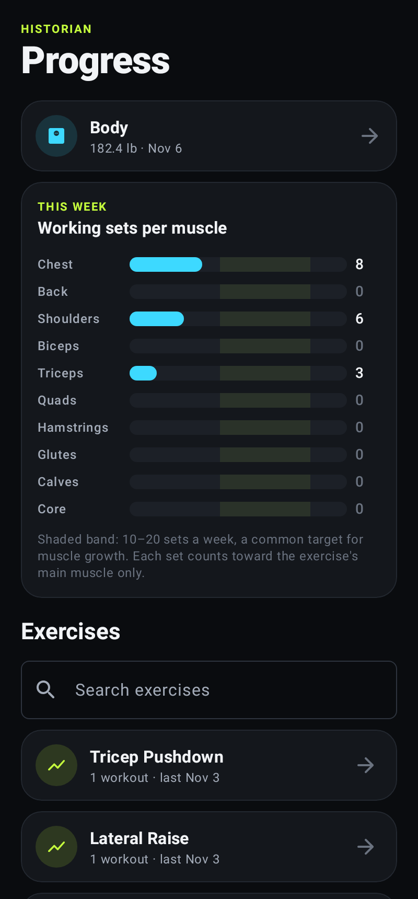

### Exercise pages
Tap an exercise to see:
- **Chart**: switch between **Est. 1RM**, **Top weight** and **Volume**, with the change since your first workout
- **Personal records**: heaviest set, best estimated 1RM, best-volume workout, most reps
- **Every workout** with that exercise. Tap one to open it.
- **Muscle** pill: tap to change which muscle it counts toward
- ✎ (top right): rename the exercise

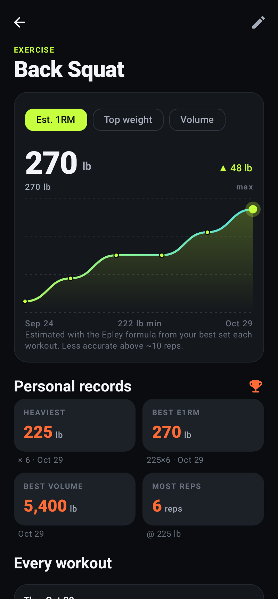

---

## 9. Recovery map

Open it from the **Recovery** card on the Train tab. Each muscle is coloured:

| Colour | Status | Rule |
|---|---|---|
| 🟠 Orange | **Recovering** | Trained in the last 24 hours, or 6+ hard sets in the last 48 hours |
| 🟢 Lime | **Ready** | Trained recently and recovered |
| 🔵 Blue | **Fresh** | No hard sets in 4+ days |

The list below the figure shows the sets and time since each muscle was last trained.

This is a simple rule of thumb based on your log, not a measurement. If something still feels beat up, trust that over the colour.

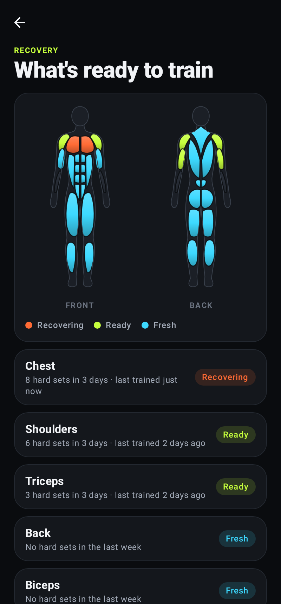

---

## 10. Body tracking

**Progress → Body** tracks:
- **Measurements:** body weight, body fat (%), waist, chest, arms, thighs and hips. Lengths are in inches when you use pounds and cm when you use kilograms.
- **Logging:** pick a measurement and tap **Log …**. Entries are saved with today's date and time.
- **Chart:** shows the trend and the change since your first entry.
- **Deleting:** tap the trash icon on an entry.

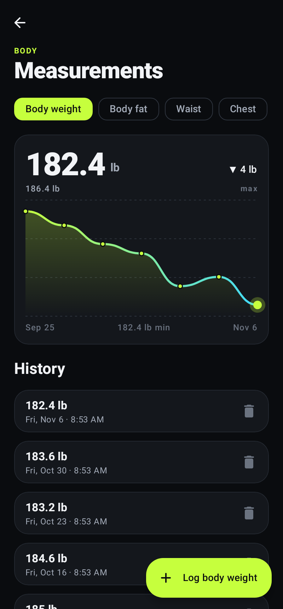

---

## 11. Settings

| Setting | What it does |
|---|---|
| **Weight unit** | Pounds or kilograms. Changes the display only; your data isn't converted or changed. |
| **Auto-start rest timer** | Start rest automatically when you tick a set. |
| **Track RPE** | Adds the RPE column to workouts (and lets RPE influence progression). |
| **Empty bar weight** | Used by the plate calculator and warm-ups (45/35/25/15 lb or 20/15/10 kg). |
| **Default rest** | Rest time for exercises added during a workout. |
| **Readiness check-in** | Ask "How are you today?" before program days. |
| **Health Connect → Sync workouts** | Write finished workouts to Health Connect (see below). |
| **Back up everything** | Save all programs and history to one file. |
| **Restore from backup** | Replace everything on this phone with a backup file. |
| **Export sets to CSV** | Every completed set as a spreadsheet file. |

### Health Connect
Health Connect is Android's on-phone health data hub. With **Sync workouts** on:
- Each finished workout is written to it as a strength-training session, with each set and its reps. Apps that read Health Connect (e.g. Samsung Health) can show it.
- **Sync all past workouts again** sends your whole history. Running it again won't create duplicates.
- LiftLog only **writes** workouts. It never reads your other health data.
- On Android 13 and older you may need to install Health Connect from the Play Store first; the settings panel shows a **Get Health Connect** button when needed.

---

## 12. Keeping your data safe

Everything is stored **only on your phone**. There's no account or cloud copy.

- **Back up regularly.** **Settings → Back up everything**, then save the file to Google Drive or email it to yourself. A monthly backup is a good habit.
- **Uninstalling deletes your data** unless you've made a backup.
- **New phone:** install LiftLog, then **Settings → Restore from backup** and pick your file.
- **Updates:** download the new version from the same link and install it over the old one. Your data stays. (If you installed a version older than 1.2.2, back up → uninstall → install → restore once.)

---

## 13. How the numbers are calculated

| Number | How it's worked out |
|---|---|
| **Estimated 1RM (e1RM)** | Epley formula: weight × (1 + reps ÷ 30). A single rep counts as its own weight. Less accurate above ~10 reps. |
| **Volume** | Weight × reps, added up over working sets. Warm-ups are left out. |
| **Sets** | Completed working sets. Warm-ups are left out. |
| **Personal records** | From finished workouts, working sets only. |
| **Monthly recap records** | An exercise counts as a record when the month's best e1RM beats every earlier month. A first-ever exercise doesn't count. |
| **Week streak** | Consecutive calendar weeks (Mon–Sun) with at least one workout. |
| **Rest before** | Time between checking off one set and the next, so it includes the set itself. |
| **Rounding** | Planned weights are rounded to loadable jumps: 5 lb or 2.5 kg. |

---

## 14. Troubleshooting

**The rest alert didn't go off.**
- Check that notifications are on: Android Settings → Apps → LiftLog → Notifications.
- Some phones (especially with aggressive battery saving) can close apps in the background. Set LiftLog's battery usage to **Unrestricted** in Android Settings → Apps → LiftLog → Battery.

**The weights didn't go up.**
Look at the note on the exercise card; it says why. Common reasons:
- a missed rep
- an RPE 10 set
- the last workout was a lighter day
- the exercise's progression is set to **None**

**An exercise won't delete.**
Exercises used in any program or past workout can't be deleted (it would break your history). Rename it instead.

**A deleted built-in exercise came back.**
That only happens once, when an update adds new built-in exercises. Delete it again and it stays deleted.

**"App not installed" when updating.**
You're updating from a version older than 1.2.2. Back up, uninstall, install the new version, then restore.

**Known limitations**
- **Rest timer:** if Android force-closes the app during a rest, that rest's alert won't fire.
- **Rest before:** times aren't recalculated if you un-check a set or check sets out of order.
- **Program editor:** rotating the phone closes the exercise-settings dialog.
- **Muscle counts:** each exercise counts toward one muscle only.
- **Devices:** iPhone isn't supported.
